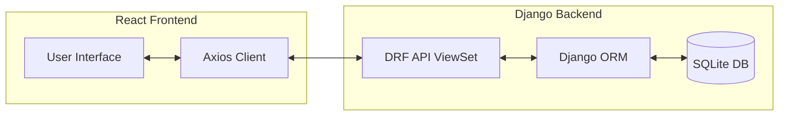

# Django React Todo App

A full-stack Todo application built with Django REST Framework (backend) and React (frontend).

---

## 📋 Table of Contents

- [Overview](#-overview)
- [Architecture](#-architecture)
- [Features](#-features)
- [Tech Stack](#-tech-stack)
- [Prerequisites](#-prerequisites)
- [Getting Started](#-getting-started)
  - [Backend Setup](#backend-setup)
  - [Frontend Setup](#frontend-setup)
  - [Docker Setup (Recommended)](#docker-setup-recommended)
- [API Documentation](#-api-documentation)
- [Development](#-development)
- [Credits](#-credits)

---

## 🌟 Overview

This project is a simple yet powerful Todo application that demonstrates how to integrate a Django backend with a React frontend. It provides a clean interface for managing tasks, supporting full CRUD (Create, Read, Update, Delete) operations.

## 🏗 Architecture

The project is split into two main components:
1.  **Backend**: A Django application providing a RESTful API using Django REST Framework.
2.  **Frontend**: A React application that consumes the API and provides a dynamic user interface.



## ✨ Features

- **Create Tasks**: Add new tasks with a title and description.
- **View Tasks**: List all tasks, filtered by completion status.
- **Update Tasks**: Edit existing tasks or mark them as complete/incomplete.
- **Delete Tasks**: Remove tasks from the list.
- **Responsive Design**: Built with Bootstrap for a great experience on all devices.

## 💻 Tech Stack

**Backend:**
- Python 3.6+
- Django 2.2
- Django REST Framework
- Django CORS Headers
- SQLite (Development Database)

**Frontend:**
- React 16.8
- Axios (API Requests)
- Bootstrap 4 & Reactstrap (UI Components)

---

## 🚀 Getting Started

### Prerequisites

- Python 3.x
- Node.js & npm (or Yarn)
- `pipenv` (recommended for Python environment management)

### Backend Setup

1. Navigate to the `backend` directory:
   ```bash
   cd backend
   ```

2. Install dependencies:
   ```bash
   pipenv install
   ```

3. Activate the virtual environment:
   ```bash
   pipenv shell
   ```

4. Run migrations:
   ```bash
   python manage.py migrate
   ```

5. Start the Django development server:
   ```bash
   python manage.py runserver
   ```
   The backend will be available at `http://localhost:8000`.

### Frontend Setup

1. Navigate to the `frontend` directory:
   ```bash
   cd frontend
   ```

2. Install dependencies:
   ```bash
   npm install
   # or
   yarn install
   ```

3. Start the React development server:
   ```bash
   npm start
   # or
   yarn start
   ```
   The frontend will be available at `http://localhost:3000`.

### Docker Setup (Recommended)

If you have Docker and Docker Compose installed, you can start the entire stack with a single command:

1. Build and start the containers:
   ```bash
   docker-compose up --build
   ```

2. The application will be accessible at:
   - Frontend: `http://localhost:3000`
   - Backend API: `http://localhost:8000`

---

## 📡 API Documentation

The backend provides a RESTful API at `/api/todos/`.

| Method | Endpoint | Description |
| :--- | :--- | :--- |
| `GET` | `/api/todos/` | List all tasks |
| `POST` | `/api/todos/` | Create a new task |
| `GET` | `/api/todos/{id}/` | Retrieve a specific task |
| `PUT` | `/api/todos/{id}/` | Update a specific task |
| `PATCH` | `/api/todos/{id}/` | Partially update a task |
| `DELETE` | `/api/todos/{id}/` | Delete a task |

### Example Request (Create)
```json
POST /api/todos/
{
    "title": "Learn Django",
    "description": "Build a REST API",
    "completed": false
}
```

---

## 🛠 Development

### Backend Models
The `Todo` model is defined in `backend/todo/models.py`:
```python
class Todo(models.Model):
    title = models.CharField(max_length=120)
    description = models.TextField()
    completed = models.BooleanField(default=False)
```

### Frontend API Calls
Axios is used to interact with the backend. Example from `App.js`:
```javascript
refreshList = () => {
  axios
    .get("http://localhost:8000/api/todos/")
    .then(res => this.setState({ todoList: res.data }))
    .catch(err => console.log(err));
};
```

---

## 📜 Credits

Originally based on the tutorial by [Scotch.io](https://scotch.io/tutorials/build-a-to-do-application-using-django-and-react).